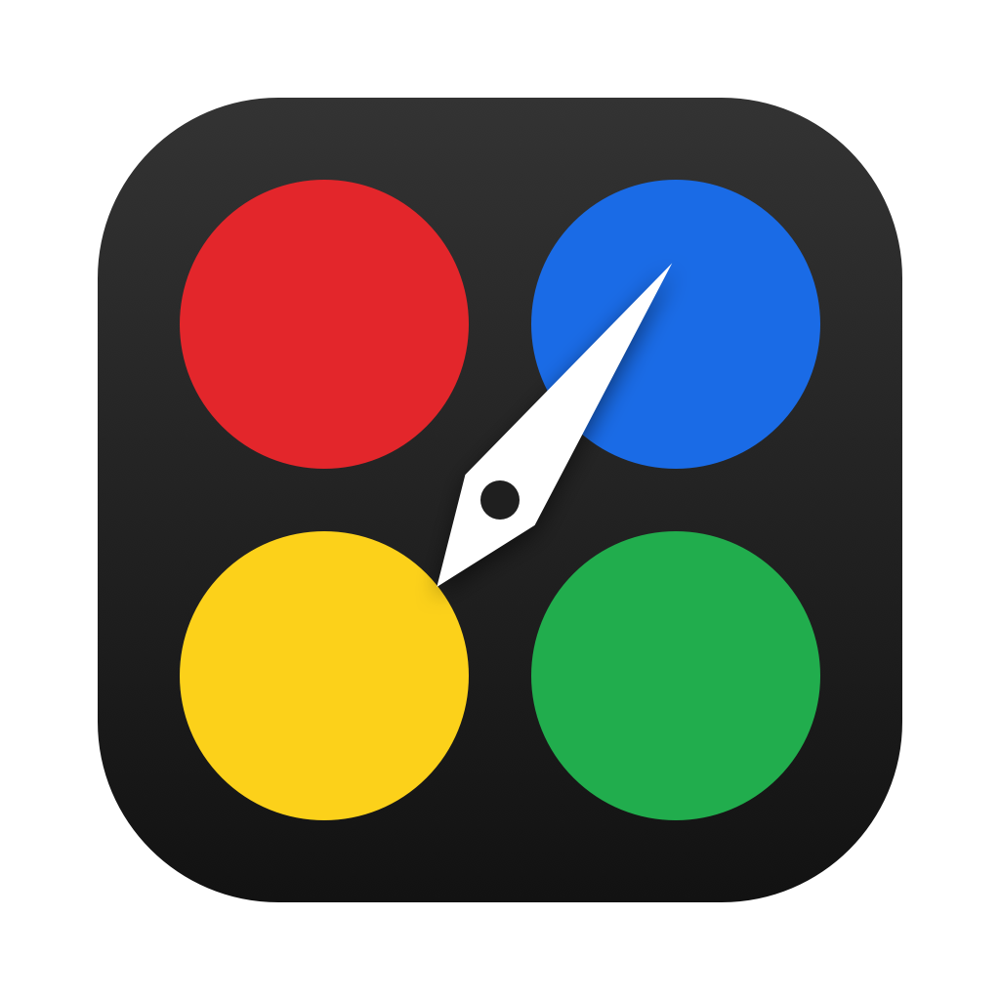
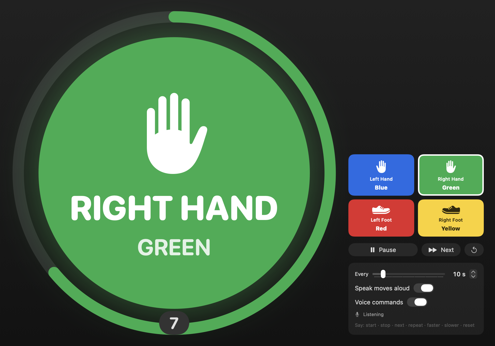
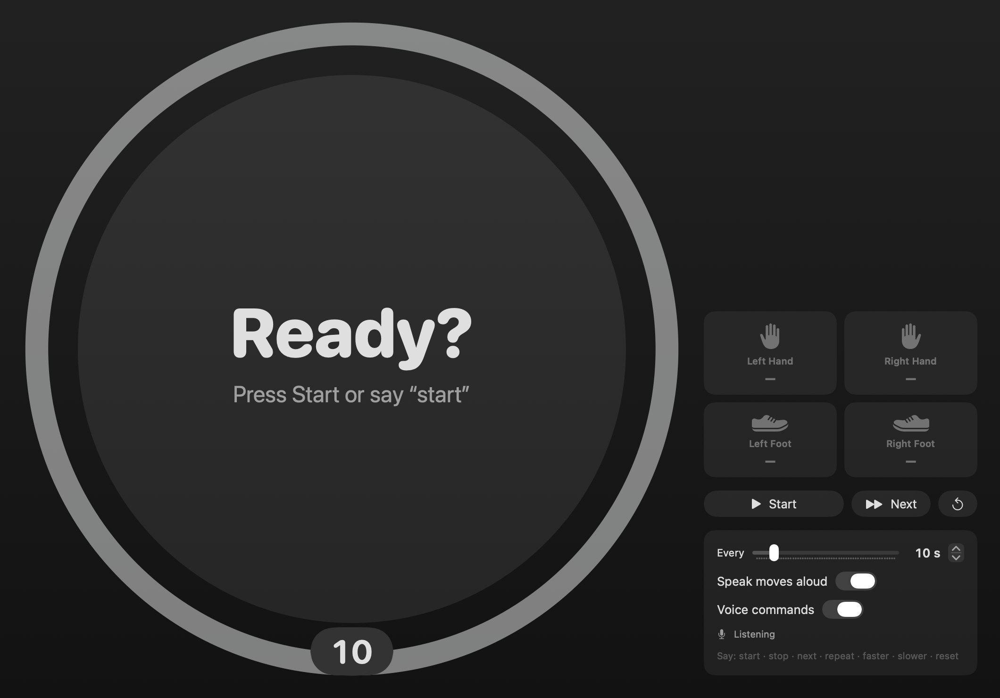

# Twist Caller

A native macOS app that calls out the next move for a game of Twister — "Right Hand, Red", "Left Foot, Blue" — on a timer, out loud, so nobody has to sit out and work the spinner.



## What it does

- **Calls a move on a timer.** Every 10 seconds by default, adjustable from 3 to 60 seconds. A ring around the call counts down to the next one.
- **Says it aloud** using the Mac's built-in voice, and shows it large enough to read from across the room.
- **Tracks where everyone should be.** The panel on the right shows the colour each hand and foot is currently on, with the limb that just moved outlined.
- **Takes voice commands**, so you can run it while tangled up on the mat.
- **Never calls a no-op.** Each call moves a limb to a different colour than the one it is on.



## Voice commands

| Say | It does |
|---|---|
| "start", "go", "resume", "begin", "play" | Starts the timer |
| "stop", "wait", "hold" | Pauses |
| "next", "skip" | Calls a new move immediately |
| "repeat", "again" | Says the current move again |
| "faster" / "slower" | Shortens / lengthens the interval by 5 seconds |
| "reset" | Clears the game |

Voice commands need Microphone and Speech Recognition permission (macOS asks on first launch) and work best with Dictation turned on in **System Settings › Keyboard**. With Dictation off, the app falls back to macOS's older command recognizer, which is less accurate.

Recognition runs on-device where the Mac supports it.

## Keyboard

| Key | Action |
|---|---|
| Space | Start / pause |
| → | Next move now |
| ⌘R | Reset |

## Build and run

Requires macOS 13 or later and the Xcode command line tools (`xcode-select --install`). There is no Xcode project; one script compiles the single Swift file and assembles the app bundle.

```bash
./build.sh
open "Twist Caller.app"
```

To install it, drag `Twist Caller.app` into `/Applications`.

The build signs the app with the first code-signing certificate in your keychain, if you have one, so macOS remembers the microphone permission across rebuilds. Without one it signs ad-hoc, and macOS will ask for permission again after each rebuild.

## Project layout

| File | Purpose |
|---|---|
| `main.swift` | The whole app: game model, voice control, SwiftUI views |
| `icon.swift` | Draws the app icon |
| `build.sh` | Builds the icon, compiles, bundles and signs |

The screenshots above are rendered by the app itself:

```bash
"Twist Caller.app/Contents/MacOS/TwistCaller" --screenshot "$PWD/docs"
```

Setting the `TWIST_LOG` environment variable to a file path makes the app log what the speech recognizer hears, which helps when a command isn't being picked up.

---

Twister is a trademark of Hasbro. This project is an unofficial companion tool and is not affiliated with or endorsed by Hasbro.
